# 🔥 RSS: Representation Redistribution in Sparse Autoencoders

**Ziye Mei, Haotian Ma**<br>
University of Wisconsin–Madison

🌍 [English](README.md) | [中文](README_cn.md)

👉 TL;DR. Prompt transformations designed to keep the request the same can still redistribute activity across sparse
autoencoder features. We introduce the redistribution sensitivity score, RSS, which selects large feature responses that
recur in a consistent direction, and we evaluate the selected features on variants excluded from selection. Across 27
pretrained SAEs from eight language models, the tested transformations produce a reproducible redistribution profile.
In two frozen safety readouts, combining RSS support erosion with the clean margin gives recurrent failure AUROCs of
0.935 and 0.958 with median supports of 20 and 19 features, compared with 0.965 and 0.964 using full erosion.

<p align="center">
  <b>📄 arXiv paper coming soon</b> &nbsp; | &nbsp;
  <a href="https://uniquemax2005.github.io/rss-redistribution/"><b>🎞️ 5-minute tutorial</b></a> &nbsp; | &nbsp;
  <a href="#-demo"><b>🧪 Demo</b></a>
</p>

## 🎥 Overview

<p align="center">
  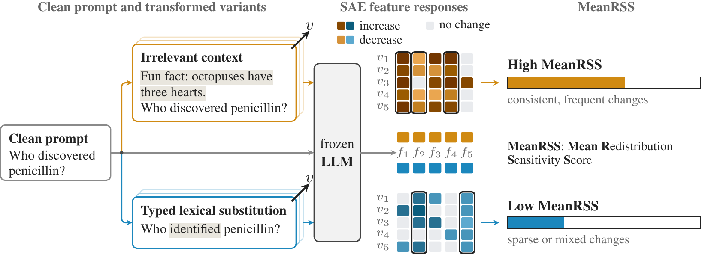
</p>

**Figure 1.** RSS under prompt transformations. In the illustrated five-variant selection, boxed features change in the
same direction in at least four variants. MeanRSS averages their absolute response magnitudes.

---

## 🎞️ 5-Minute Tutorial

<p align="center">
  <a href="https://uniquemax2005.github.io/rss-redistribution/">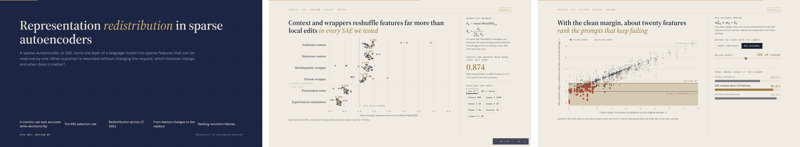</a>
</p>

💻 Click the preview to open the tutorial in your browser, or go to
<https://uniquemax2005.github.io/rss-redistribution/>. Use the arrow keys to move between slides. Press N for the talk
track and D for details on each slide. The same page is the single file [`docs/index.html`](docs/index.html), which also
works offline.

---

## ✨ Highlights

- 🔁 **A reproducible profile.** In all 27 SAEs, context and wrapper transformations move the representation more than
  local edits. The normalized gap is 0.874, and the context and wrapper mean is larger for all 1,000 prompts.
- 🎯 **A simple selection rule.** RSS keeps the largest feature changes that respond in at least four of five variants
  and point the same way in at least 80% of them.
- 🧭 **Directions persist.** On held out variants, RSS features respond in their selected direction at a rate of 0.952,
  compared with 0.758 for random features of the same number.
- 🧮 **Change is not failure.** For a fixed linear readout, the contribution of a selected feature splits exactly into
  its readout weight, its response size and its alignment with the selected direction. Whether a decision flips also
  depends on the clean margin.
- 🛡️ **Compact and useful.** RSS features are chosen without the readout. Yet 20 and 19 of them reconstruct held out
  logit changes with $`R^2`$ of 0.58 and 0.63 and keep most of the full readout's failure ranking.
- ⚡ **Small code.** The selector is one NumPy function, [`rss.py`](rss.py). The GPT-2 demo runs in about a minute on a
  CPU.

---

## 💡 Why RSS?

Sparse autoencoders, or SAEs, decompose dense language model activations into sparse features. Related inputs can
change which features respond, and prompt variations such as added context, formatting or word substitution can also
change model behavior. Using SAE features to describe this variation requires separating responses specific to one
input from patterns that recur across related inputs.

Tracking one feature shows its response but misses changes elsewhere. Aggregate activation distances summarize the
overall change but do not identify the features that carry it. We call the change in how activity is distributed across
the sparse basis representation redistribution. RSS selects the features whose changes are large and recur in one
direction. It fixes them on one set of variants and evaluates them on disjoint variants.

A recurring change need not matter downstream. A selected feature can receive little readout weight, contributions of
different features can cancel, and a change in readout score need not cross the decision threshold. We therefore
measure the contribution of the selected changes to a fixed linear readout separately and compare it with the margin
left on the clean input.

---

## 📐 What RSS Measures

🧩 **Feature changes.** All quantities are defined for one pretrained SAE, layer, base prompt and transformation
setting. Let $`x_0`$ be the clean prompt and $`x_v`$ with $`v\in V`$ its transformed variants. At the aligned target
position, $`a_f(x)`$ is the activation of feature $`f`$. Its change and average response magnitude are

$$\delta_{v,f}=a_f(x_v)-a_f(x_0),\qquad h_f=\frac{1}{\lvert V\rvert}\sum_{v\in V}\lvert\delta_{v,f}\rvert .$$

Because $`h_f`$ averages absolute changes, opposite directions do not cancel.

🔁 **Recurrence and direction.** Let $`n_f^{+}`$ count the $`n`$ selector observations greater than $`\tau`$ and $`n_f^{-}`$
those less than $`-\tau`$. Then

$$r_f=\frac{n_f^{+}+n_f^{-}}{n},\qquad c_f=\frac{\max(n_f^{+},n_f^{-})}{n_f^{+}+n_f^{-}},\qquad s_f=\mathrm{sign}(n_f^{+}-n_f^{-}).$$

Here $`r_f`$ measures recurrence, $`c_f`$ directional consistency and $`s_f`$ the dominant direction.

🎯 **The RSS support and MeanRSS.** Among the $`M`$ features with the largest $`h_f`$, a feature is eligible when
$`r_f\ge\rho`$ and $`c_f\ge\kappa`$. RSS keeps the $`k=\min(K,\lvert\mathcal E_M\rvert)`$ eligible features with the largest
$`h_f`$ as the responsive support $`S`$, and

$$\mathrm{MeanRSS}=\frac{1}{\lvert S\rvert}\sum_{f\in S}h_f .$$

We use $`\rho=\kappa=0.8`$, $`\tau=10^{-5}`$, $`M=400`$ and $`K=20`$. With $`n=5`$ observations, every selected feature changes
in its dominant direction at least four times and in the opposite direction at most once.

📏 **Normalized MeanRSS and held out contrast.** To compare SAEs of different scale, average MeanRSS over prompts $`i`$
for each setting $`g`$ and divide by the mean of the six settings,

$$R_g=\mathrm{mean}_i\,\mathrm{MeanRSS}_{i,g},\qquad \widetilde R_g=\frac{R_g}{\frac{1}{6}\sum_{g'}R_{g'}} .$$

The six values of each SAE then have mean one. For a feature set $`A`$, $`H_g(A)`$ averages $`\lvert\delta_{v,f}\rvert`$
over prompts, features in $`A`$ and held out variants, and $`\widetilde H_g(A)`$ normalizes it in the same way. With
$`\mathcal C`$ the four context and wrapper settings and $`\mathcal L`$ the two local edits, the held out contrast is

$$\Delta(A)=\frac{1}{4}\sum_{g\in\mathcal C}\widetilde H_g(A)-\frac{1}{2}\sum_{g\in\mathcal L}\widetilde H_g(A).$$

🛡️ **Margin and erosion.** A frozen linear probe reads standardized activations $`\widetilde{\mathbf a}(x)`$ with score
$`z(x)=\mathbf w^\top\widetilde{\mathbf a}(x)+b`$ and threshold $`t`$. For class sign $`y\in\lbrace -1,+1\rbrace`$ the
margin is $`m(x)=y\,[z(x)-t]`$, so a positive margin means a correct decision, and $`m_0=m(x_0)`$ is the clean margin.
Over a variant set $`U`$, feature $`f`$ erodes the margin by

$$e_f^U=-y\,w_f\,\frac{1}{\lvert U\rvert}\sum_{v\in U}\widetilde\delta_{v,f}.$$

For a selected feature this factors exactly as $`e_f^U=-y\,w_f\,s_f\,A_f^U\,\eta_f^U`$. Here $`A_f^U`$ is the mean absolute
standardized response and $`\eta_f^U\in[-1,1]`$ its alignment with the selected direction. On the selection variants
the full erosion and the part carried by the support are $`E=\sum_f e_f`$ and $`E_S=\sum_{f\in S}e_f`$.

🧾 **Residual margin and retention.** Subtracting erosion from the clean margin gives the residual margins
$`m_{\mathrm{res}}=m_0-E`$ and $`m_{\mathrm{res}}^{S}=m_0-E_S`$. The full residual margin equals the average transformed
margin on the selection variants. On held out variants, margin contribution retention is the share of absolute
contribution kept by the support,

$$\mathrm{MCR}=\frac{\sum_{f\in S}\lvert e_f^{\mathrm{ho}}\rvert}{\sum_f\lvert e_f^{\mathrm{ho}}\rvert}.$$

⚠️ **Failure, AUROC and review.** For each test prompt and setting, one realization per operator gives five selection
variants and the other two give ten held out variants. A recurrent readout failure means that at least two of the ten
held out margins are negative. For a risk score $`q`$, AUROC is the probability that a failing case $`i`$ is ranked above
a case $`j`$ without failure,

$$\mathrm{AUROC}=\Pr\big(q(i)>q(j)\big).$$

Selective review ranks cases by residual margin and reports the share of held out errors among the riskiest 20%.

🔧 **Reconstruction and restoration.** For a held out variant, the logit change $`d=z(x_v)-z(x_0)`$ is compared with
the support sum $`\widehat d_S=\sum_{f\in S}w_f\widetilde\delta_{v,f}`$ by the coefficient of determination $`R^2`$.
Restoring the selected readout inputs to their clean values gives

$$m_{\mathrm{cf}}(x_v)=m_0+y\sum_{f\notin S}w_f\widetilde\delta_{v,f}.$$

A transformed error with $`m_{\mathrm{cf}}(x_v)>0`$ is reversed. This counterfactual changes only the readout
computation, not the activations of the language model.

---

## 🔎 Comparison of Methods

🧭 **Which features carry the transformation contrast.** RSS is compared with three feature sets that do not look at
the transformation. Clean fixed takes features selected from clean prompts. Global fixed takes features selected by
activity across the clean corpus. Dictionary mean is an equal average over all SAE features. Each set is evaluated on
held out variants with $`\Delta(A)`$, and a larger value means a clearer contrast. Numbers are averages over the 27 SAEs
in Figure 3.

| Feature set | Held out contrast $`\Delta(A)`$ | SAEs where RSS is larger |
|---|:---:|:---:|
| 🏆 **RSS** | ✅ **0.504** | |
| Clean fixed | 0.376 | ✅ 24 of 27 |
| Global fixed | 0.365 | ✅ 26 of 27 |
| Dictionary mean | ❌ 0.306 | ✅ 24 of 27 |

🎯 **Whether the selected direction persists.** Large changes might already be stable without the recurrence and
consistency constraints. We therefore compare RSS with selection by magnitude alone, using the same candidate pool and
support size. The number is the held out response rate in the selected direction for the two safety probes.

| Selection | Gemma 3 4B | Llama 3.1 8B |
|---|:---:|:---:|
| 🏆 **RSS** | ✅ **0.876** | ✅ **0.871** |
| Magnitude alone | 0.816 | 0.794 |

🛡️ **Which score ranks readout failures.** All scores are computed on the five selection variants and judged by AUROC
for recurrent failure on the ten held out variants. MeanRSS uses only the response size of the support, and the second
row weights it by absolute probe coefficients. Clean margin uses the probe on the clean prompt alone. The other rows
use the erosion terms defined above.

| Score | Features | Gemma 3 4B | Llama 3.1 8B |
|---|:---:|:---:|:---:|
| MeanRSS | RSS support | ❌ 0.526 | ❌ 0.506 |
| MeanRSS with probe weights | RSS support | ❌ 0.676 | ❌ 0.581 |
| RSS erosion $`E_S`$ | RSS support | 0.753 | 0.735 |
| Full erosion $`E`$ | all | 0.785 | 0.705 |
| Clean margin $`m_0`$ | all | 0.863 | 0.901 |
| 🏆 **RSS residual margin** $`m_{\mathrm{res}}^{S}`$ | ✅ **20 and 19** | ✅ **0.935** | ✅ **0.958** |
| Full residual margin $`m_{\mathrm{res}}`$ | 415 and 862 | 0.965 | 0.964 |

🔬 **Which features localize the readout change.** Each support has the size of the RSS support. Mismatched setting
uses the RSS support selected for another transformation. Global instability uses the features that vary most across
the corpus, and random uses random features. $`R^2`$ measures how well the support reconstructs held out logit changes,
and errors reversed is the share of transformed probe errors corrected by restoring the support.

| Support | $`R^2`$ Gemma | $`R^2`$ Llama | Errors reversed Gemma | Errors reversed Llama |
|---|:---:|:---:|:---:|:---:|
| 🏆 **RSS** | ✅ **0.579** | ✅ **0.627** | ✅ **72.2%** | ✅ **71.8%** |
| Mismatched setting | 0.438 | 0.490 | 60.3% | 61.1% |
| Global instability | ❌ 0.017 | ❌ 0.009 | ❌ 6.7% | ❌ 2.3% |
| Random | ❌ 0.014 | ❌ 0.017 | ❌ 1.2% | ❌ 1.5% |

---

## ⚙️ Install

```bash
git clone https://github.com/UniqueMax2005/rss-redistribution.git
cd rss-redistribution
python -m venv .venv && source .venv/bin/activate
pip install -r requirements.txt
```

`rss.py` needs only NumPy, so `pip install numpy` is enough for the selector. The demo also needs PyTorch, TransformerLens,
SAE Lens and Matplotlib. The demo output below comes from Python 3.12 with the versions in
[`requirements-lock.txt`](requirements-lock.txt), and `pip install -r requirements-lock.txt` installs exactly those.

✅ **Tests.** `python -m pytest` checks the properties the paper relies on. They cover the strict threshold, an empty
support that stays unavailable, Propositions 1 and 2, invariance to scale and to the order of features and variants,
input checks and the Quickstart output of both READMEs. GitHub Actions runs them on every push.

---

## 🚀 Quickstart

```python
import numpy as np
from rss import rss

# SAE activations of 5 variants minus the clean prompt, one row per variant and one column per feature
delta = np.array([[2.0, 0.0, -1.0,  0.3],
                  [1.8, 0.0, -1.2, -0.3],
                  [2.2, 0.5, -0.9,  0.3],
                  [1.9, 0.0, -1.1, -0.3],
                  [0.0, 0.0, -1.0,  0.3]])

support, direction, mean_rss = rss(delta)   # rho = kappa = 0.8, tau = 1e-5, M = 400, K = 20
print(support, direction, round(mean_rss, 2))
# [0 2] [ 1 -1] 1.31
```

💡 Feature 0 goes up in four of five variants and feature 2 goes down in all five, so both are kept. Feature 3 changes
every time but flips its direction, so it is dropped.

👉 On GPT-2 Small

```bash
python demo.py
```

🧰 **Your own SAE.** Write variants of each clean prompt that keep the request and contain the target phrase exactly
once. Read the SAE at the last token that overlaps the target phrase, as `sae_features` in [`demo.py`](demo.py) does.
Split the variants into selection and held out variants before looking at any feature, select on the first set and check
the selected directions on the second.

```python
from rss import rss, held_out_rate

# a0 has shape (n_features,), a_sel and a_ho have shape (n_variants, n_features)
support, direction, mean_rss = rss(a_sel - a0)
rate = held_out_rate(a_ho - a0, support, direction)   # one value per selected feature
```

`held_out_rate` is the held out response rate of Equation 20 in the paper, the quantity in Figure 4A. Both functions
raise an error for nan or inf values, a wrong shape or a parameter outside its range, so a bad input never returns a
plausible number.

---

## 📊 Main Results

#### 🔁 Figure 2. Normalized MeanRSS across six prompt transformations and 27 pretrained SAEs

Normalized MeanRSS $`\widetilde R_g`$ averaged over the 27 SAEs with equal weight.

| Irrelevant context | Distractor context | Metalinguistic wrapper | Format wrapper | Punctuation noise | Typed lexical substitution |
|:---:|:---:|:---:|:---:|:---:|:---:|
| **1.466** | **1.341** | **1.199** | **1.159** | 0.525 | 0.309 |

The context and wrapper mean exceeds the local edit mean in all 27 SAEs, with an average difference of 0.874 and a 95%
interval of 0.867 to 0.881. It does so for all 1,000 prompts, and every context or wrapper setting exceeds both local
edits for 997. Across four intensity levels, the median prompt level Spearman correlation between intensity and MeanRSS
is 0.95 for punctuation edits, 0.74 for irrelevant context and 0.50 for the format wrapper.

#### 🧭 Figure 3. Response contrast on variants excluded from feature selection

RSS gives a stronger context and wrapper versus local edit separation than each comparison method in 24 to 26 of 27
SAEs and gives the largest contrast in 22. On held out variants, RSS supports respond in the selected direction at a
rate of 0.952, compared with 0.758 for random supports matched in size and candidate pool.

#### 🎯 Figure 4. Feature validation on held out variants

| | Gemma 3 4B | Llama 3.1 8B |
|---|:---:|:---:|
| Response rate in the selected direction, RSS and magnitude alone | **0.876** and 0.816 | **0.871** and 0.794 |
| Mean $`\lvert e_f^{\mathrm{ho}}\rvert`$, RSS and weight matched features | **0.240** and 0.022 | **0.370** and 0.022 |
| Matched pairs where RSS contributes more | 96.9% | 98.0% |
| MCR at $`K=20`$, RSS and mismatched RSS | **43.0%** and 32.6% | **56.2%** and 43.5% |

The sign rule of the factorization agrees with the sign of the held out contribution in 97.4% and 97.1% of cases. RSS
does not maximize retention. Ranking by $`\lvert e_f\rvert`$ on the selection variants uses the readout and keeps more
than 90% in both models.

#### ⚖️ Figure 5. Readout change and recurrent readout failure on held out variants

Probe AUROC stays above 0.90 under every transformation, yet 4.2% to 9.5% of decisions change. Full erosion estimated
on selection variants correlates with held out erosion at 0.923 for Gemma and 0.896 for Llama, and RSS support erosion
at 0.737 and 0.793. Clean margin alone gives recurrent failure AUROCs of 0.863 and 0.901. Subtracting RSS support
erosion from the clean margin gives 0.935 and 0.958, and the full residual margins give 0.965 and 0.964. These are
offline rankings with known class labels.

#### 🔬 Figure 6. Utility of RSS supports selected for each prompt and transformation within the frozen readout

| | Full readout | RSS support |
|---|:---:|:---:|
| Features, Gemma 3 4B and Llama 3.1 8B | 415 and 862 | **20 and 19** |
| Erosion Spearman $`\rho`$ | 0.923 and 0.896 | 0.737 and 0.793 |
| Residual margin AUROC | 0.965 and 0.964 | 0.935 and 0.958 |
| Errors captured at 20% review | 94.1% and 91.9% | 89.2% and 92.8% |
| Harmful false negatives captured at 20% review | 90.9% and 93.5% | 87.3% and 94.4% |

RSS reconstructs held out logit changes with $`R^2`$ of about 0.58 and 0.63. Restoring the selected readout inputs to
their clean values reverses 72.2% and 71.8% of transformed probe errors. The compact object is the set of changes used
for each case, not a single reduced probe that replaces the full clean computation.

---

## 🧪 Demo

`demo.py` runs GPT-2 Small with its public SAE on 24 prompts that we wrote, under six transformations with five
variants each. It reads the SAE at the last token of the part of the prompt that every variant keeps, applies `rss`
to each prompt and setting, and reports MeanRSS, the normalized value and the gap between context and wrapper settings
and local edits. `python demo.py` uses layer 8 and takes about a minute on a CPU. The option `--layer` selects 4, 6
or 10, the other GPT-2 layers in the paper.

```text
GPT-2 Small, layer 8, 24 prompts

Transformation            MeanRSS  normalized
Irrelevant context          2.121       1.107
Distractor context          2.481       1.295
Metalinguistic wrapper      1.977       1.032
Format wrapper              2.341       1.222
Punctuation noise           1.231       0.643
Typed substitution          1.344       0.702

Context and wrappers minus local edits: 0.492
Prompts where context and wrappers move more: 24 / 24
```

<p align="center">
  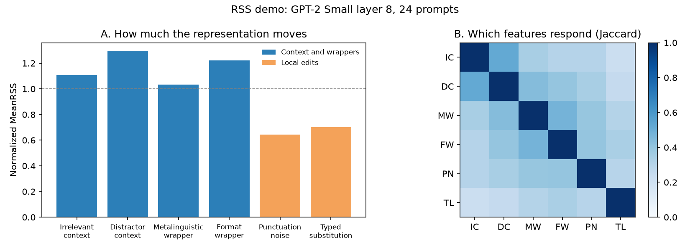
</p>

✅ The demo shows the same pattern as the paper. Context and wrapper transformations move the representation more than
local edits, and typed substitution moves a different set of features. Layers 4, 6, 8 and 10 give gaps of 0.903,
0.717, 0.492 and 0.390, with 23 or 24 of 24 prompts in the same direction. With 1,000 generated prompts the paper
reports gaps of 0.939 to 0.979 for these four layers.

---

## 🗺️ Figure Map

Captions are taken from the paper.

| Figure | Caption | In the demo |
|---|---|:---:|
| [Figure&nbsp;1](assets/figures/fig1.png) | RSS under prompt transformations. In the illustrated five-variant selection, boxed features change in the same direction in at least four variants. MeanRSS averages their absolute response magnitudes. | |
| [Figure&nbsp;2](assets/figures/fig2.png) | Normalized MeanRSS across six prompt transformations and 27 pretrained SAEs. Each SAE's six setting means are divided by their average, so the plot compares transformation profiles rather than absolute activation scales. Large outlined diamonds show averages across SAEs. | ✅ panel A |
| [Figure&nbsp;3](assets/figures/fig3.png) | Response contrast on variants excluded from feature selection. Each point is the normalized context and wrapper mean minus the local edit mean for the indicated feature set and SAE layer. Clean fixed: features selected from clean prompts. Global fixed: features selected by activity across the clean corpus. Dictionary mean: equal average over all SAE features. | |
| [Figure&nbsp;4](assets/figures/fig4.png) | Feature validation on held out variants. A, response rate in the direction chosen on selection variants, comparing RSS with magnitude alone. B, mean $`\lvert e_f^{\mathrm{ho}}\rvert`$ for RSS features and unselected features matched by readout coefficient magnitude. C–D, MCR as the support cap $`K`$ varies. The $`\lvert e_f\rvert`$ ranking uses contributions from the selection variants. | |
| [Figure&nbsp;5](assets/figures/fig5.png) | Readout change and recurrent readout failure on held out variants. A, Spearman correlation with held out margin erosion and AUROC for recurrent failure. Correlation measures erosion transfer, while AUROC measures failure ranking; residual margin correlations are oriented toward increasing risk. B, clean margin versus full residual margin for Gemma 3 4B, colored by held out recurrent failure. The dashed line marks zero average selection margin. | |
| [Figure&nbsp;6](assets/figures/fig6.png) | Utility of RSS supports selected for each prompt and transformation within the frozen readout. A, $`R^2`$ for reconstructed held out logit changes. B, readout errors reversed by restoring selected feature values. C–D, errors and harmful false negatives captured at a 20% offline review budget using known labels. Error bars show 95% bootstrap confidence intervals. | |
| [Figure&nbsp;S1](assets/figures/figS1.png) | Normalized MeanRSS profiles for the six transformations across all sampled layers of the eight models. Normalization follows Figure 2. | ✅ `--layer` |
| [Figure&nbsp;S2](assets/figures/figS2.png) | Overlap between the feature supports selected under different transformations, averaged over all units and 1,000 prompts. A, pairwise Jaccard overlap between transformations; B, averages within each model. IC denotes irrelevant context, DC distractor context, MW metalinguistic wrapper, FW format wrapper, PN punctuation noise, and TL typed lexical substitution. | ✅ panel B |
| [Figure&nbsp;S3](assets/figures/figS3.png) | Normalized MeanRSS by prompt topic. A, topic level means for each transformation; B, the ratio of the context and wrapper mean to the local edit mean for each topic. Transformation abbreviations as in Figure S2. | |
| [Figure&nbsp;S4](assets/figures/figS4.png) | Profile of the six transformations after removing one model at a time, compared with the profile over all units. Transformation abbreviations as in Figure S2. | |
| [Figure&nbsp;S5](assets/figures/figS5.png) | Comparison of the main feature selection rule with an alternative rule that treats all fifteen variants individually. A, mean support size; B, rates of undersized and empty selections; C, Jaccard overlap between the supports chosen by the two rules; D, unit level normalized MeanRSS under the two rules. Transformation abbreviations as in Figure S2. | |
| [Figure&nbsp;S6](assets/figures/figS6.png) | Probe AUROC for the two safety readouts on untransformed test prompts and under each transformation. Transformation abbreviations as in Figure S2. Error bars show 95% bootstrap confidence intervals. | |
| [Figure&nbsp;S7](assets/figures/figS7.png) | Normalized MeanRSS and margin erosion on held out variants for each transformation, evaluated on the audited safety units. Transformation abbreviations as in Figure S2. Error bars show 95% bootstrap confidence intervals. | |
| [Figure&nbsp;S8](assets/figures/figS8.png) | Effect of transformation strength on the audited safety units. A, margin erosion under three transformations rebuilt at four increasing intensity levels, with 95% bootstrap confidence intervals. B, MeanRSS for the same series, relative to the weakest level. | |
| [Figure&nbsp;S9](assets/figures/figS9.png) | Augmentation guided by MeanRSS compared with uniform sampling. A, differences between the two sampling methods in clean, mean, and worst transformation AUROC, together with the reduction in harmful false negative rate under the worst transformation. Error bars show 95% bootstrap confidence intervals. B, harmful false negative rate averaged over the six transformations across five runs. Bars show the run mean and whiskers the observed range. | |

<details>
<summary>SAEs used in the paper</summary>

From Table S3 of the paper. All 27 SAEs are public checkpoints.

| Model | Layers | SAE checkpoint | Width | Hook | Architecture and sparsity |
|---|---|---|---:|---|---|
| GPT-2 Small | 4, 6, 8, 10 | `GPT2-Small-SAEs-Reformatted` | 24,576 | `resid_pre` | ReLU, 32×, L1 coefficient $`8\times10^{-5}`$ |
| Pythia-70M | 1, 3, 5 | `pythia-70m-deduped__res-sm` | 32,768 | `resid_post` | ReLU, standard, sparsity not reported |
| Gemma 3 270M | 5, 9, 12, 15 | `gemma-scope-2-270m-pt` | 16,384 | `resid_post` | JumpReLU, $`L_0=18`$ at layer 5 and 20 elsewhere |
| Gemma 3 1B | 7, 13, 17, 22 | `gemma-scope-2-1b-pt` | 16,384 | `resid_post` | JumpReLU, $`L_0=18`$ at layer 7 and 20 elsewhere |
| Gemma 3 4B | 9, 17, 29 | `gemma-scope-2-4b-pt` | 65,536 | `resid_post` | JumpReLU, nominal $`L_0`$ of 53, 60 and 60 |
| Mistral 7B | 8, 16, 24 | `mistral_7b_layer_L` | 65,536 | `resid_pre` | ReLU, 16×, measured $`L_0`$ of 92, 74 and 75 |
| Llama 3.1 8B | 8, 16, 24 | `Llama3.1-L{8,16,24}R-8x` | 32,768 | `resid_post` | JumpReLU, 8×, measured $`L_0=50`$ |
| Gemma 2 2B | 5, 12, 19 | `gemma-scope-2b-pt-res` `width_65k` | 65,536 | `resid_post` | JumpReLU, measured $`L_0`$ of 53, 72 and 63 |

The demo loads the GPT-2 Small SAEs through SAE Lens as `gpt2-small-res-jb` at `blocks.L.hook_resid_pre`.

</details>

<details>
<summary>Show all figures</summary>

| | |
|---|---|
| 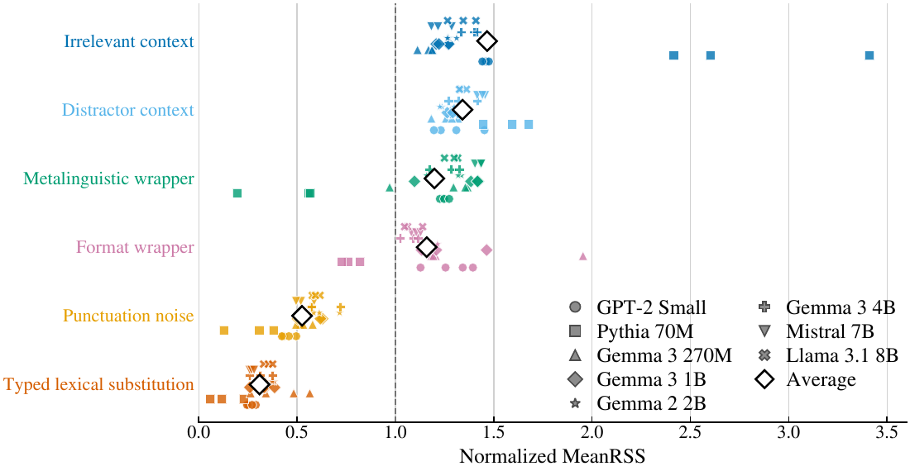<br>Figure 2 | 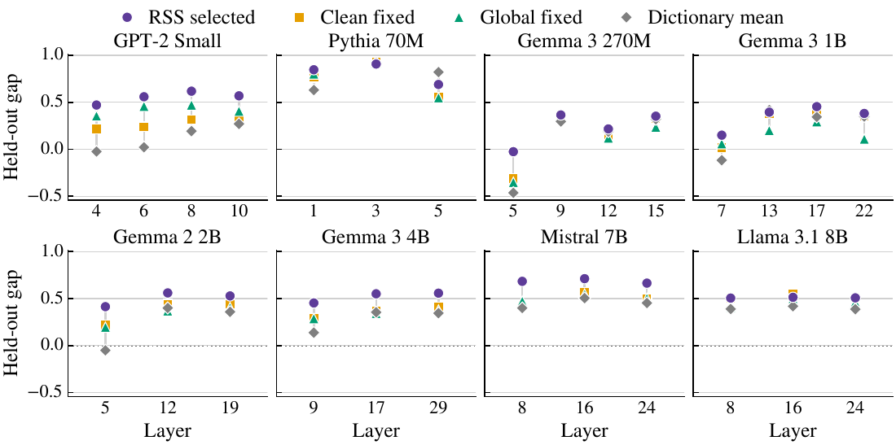<br>Figure 3 |
| 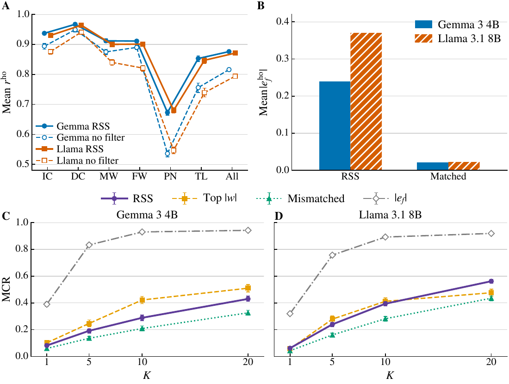<br>Figure 4 | 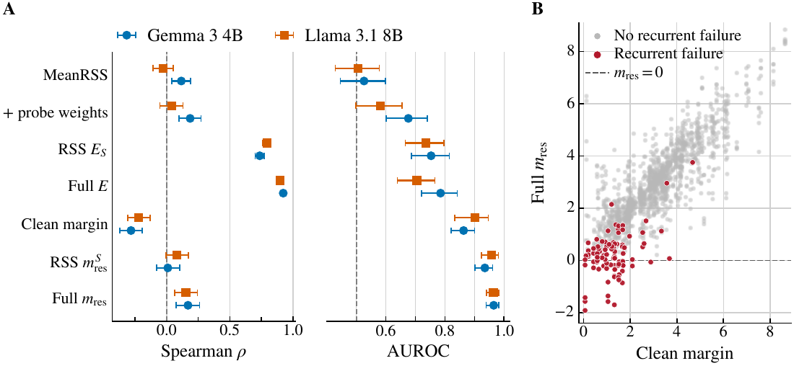<br>Figure 5 |
| 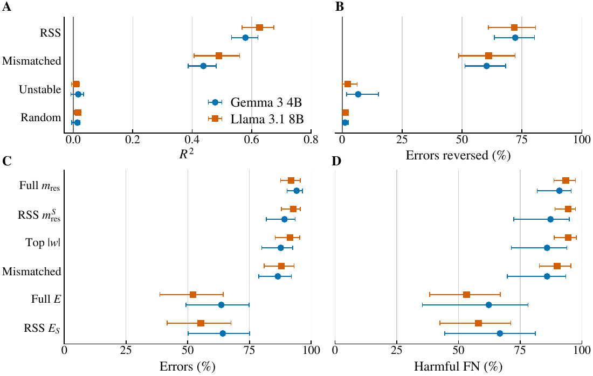<br>Figure 6 | 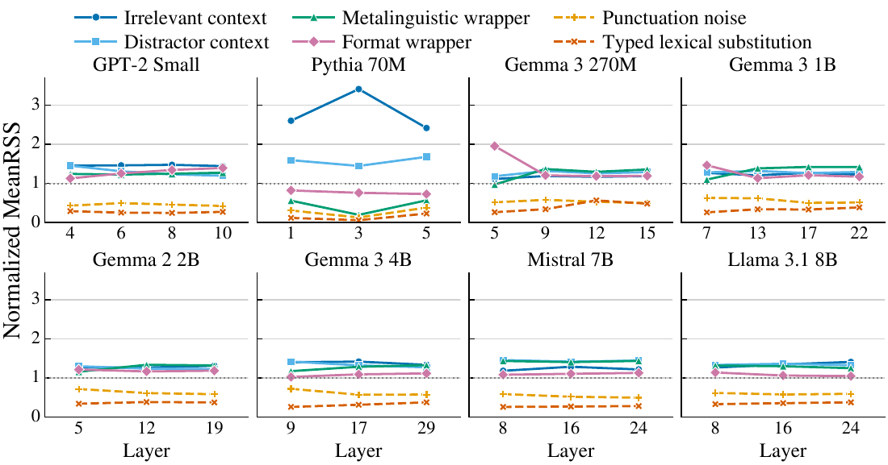<br>Figure S1 |
| 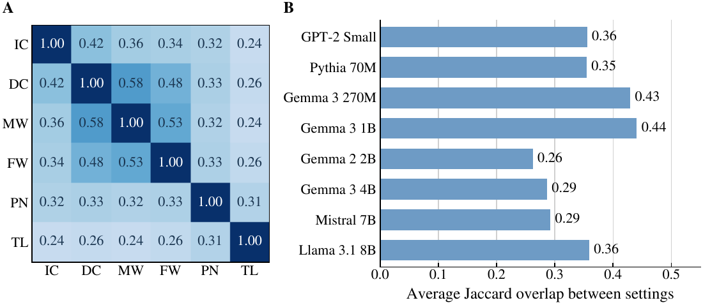<br>Figure S2 | 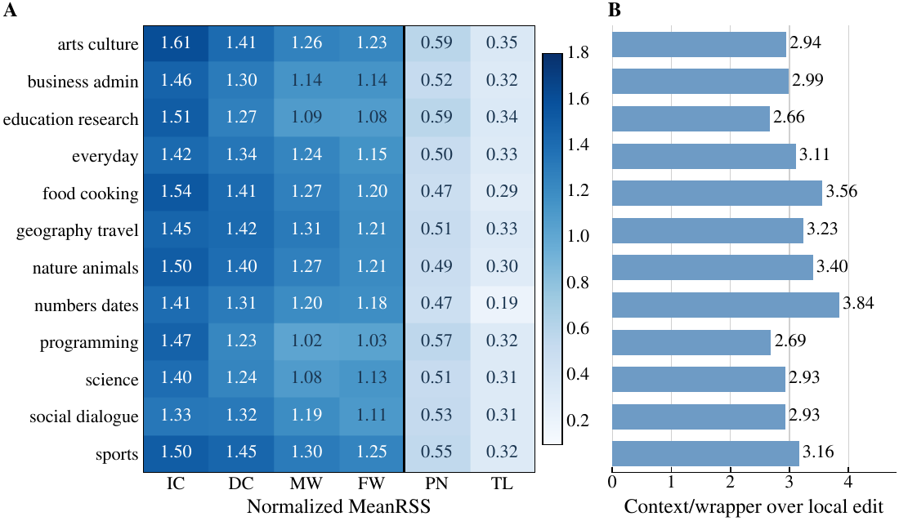<br>Figure S3 |
| 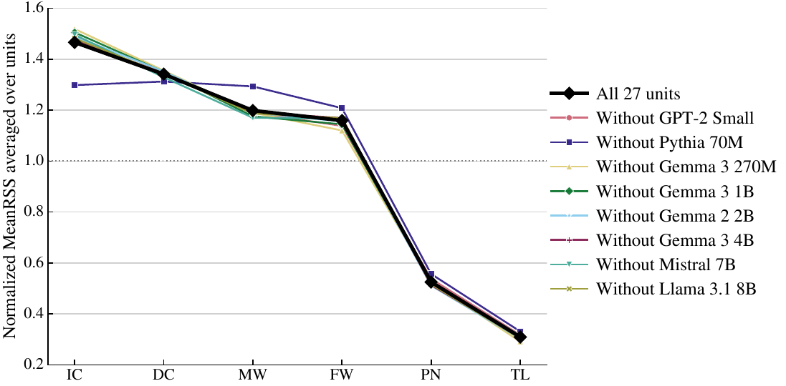<br>Figure S4 | 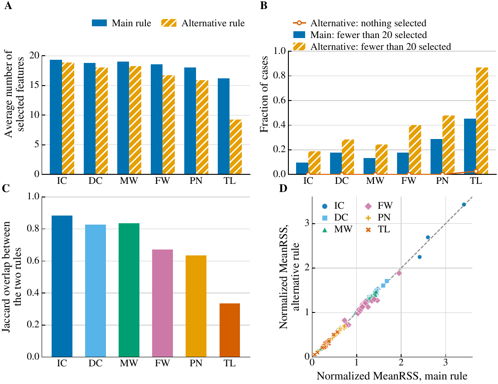<br>Figure S5 |
| 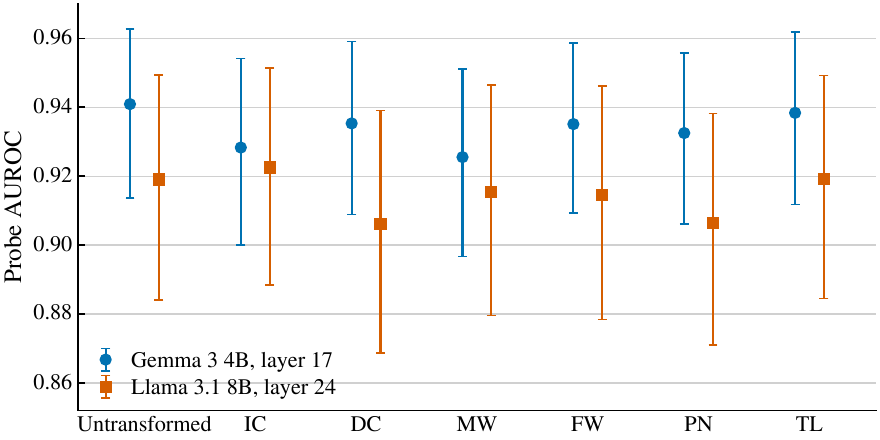<br>Figure S6 | 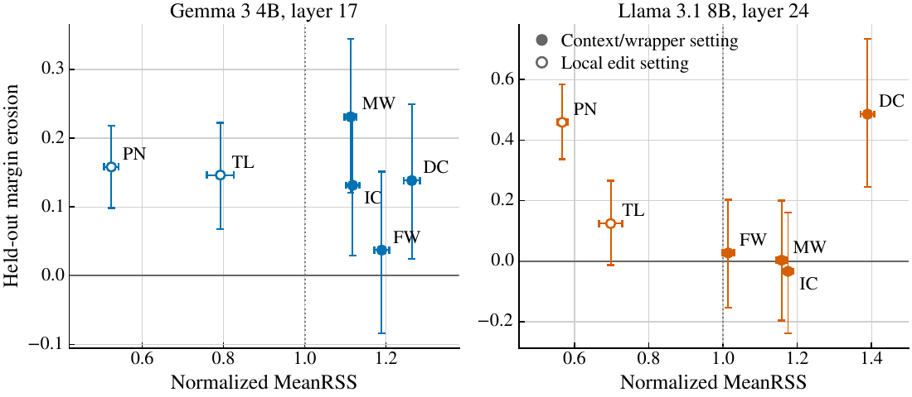<br>Figure S7 |
| 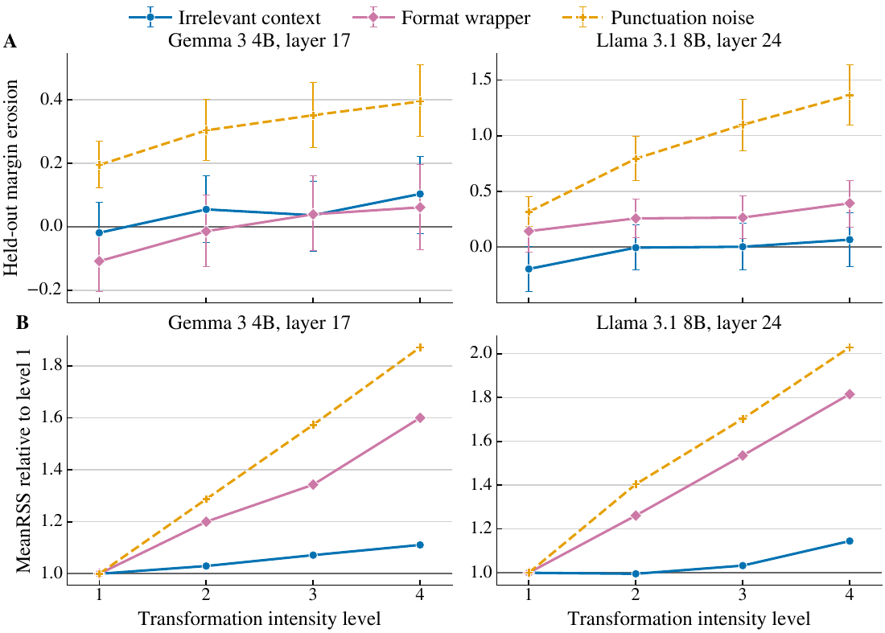<br>Figure S8 | 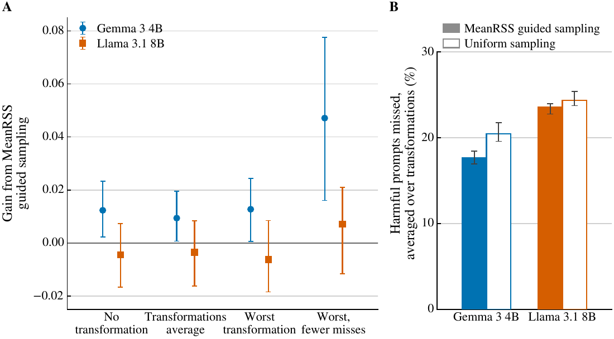<br>Figure S9 |

</details>

---

## 🙏 Appreciation

This project builds on [SAE Lens](https://github.com/decoderesearch/SAELens),
[TransformerLens](https://github.com/TransformerLensOrg/TransformerLens) and [Neuronpedia](https://www.neuronpedia.org).
It uses the open SAEs for [GPT-2 Small](https://huggingface.co/jbloom/GPT2-Small-SAEs-Reformatted),
[Pythia-70M](https://huggingface.co/ctigges/pythia-70m-deduped__res-sm_processed),
[Gemma Scope](https://huggingface.co/google/gemma-scope),
[Gemma Scope 2](https://huggingface.co/google/gemma-scope-2-4b-pt),
[Mistral-7B](https://huggingface.co/JoshEngels/Mistral-7B-Residual-Stream-SAEs) and
[Llama Scope](https://huggingface.co/OpenMOSS-Team/Llama3_1-8B-Base-LXR-8x), and the
[WildGuardMix](https://huggingface.co/datasets/allenai/wildguardmix) data.
